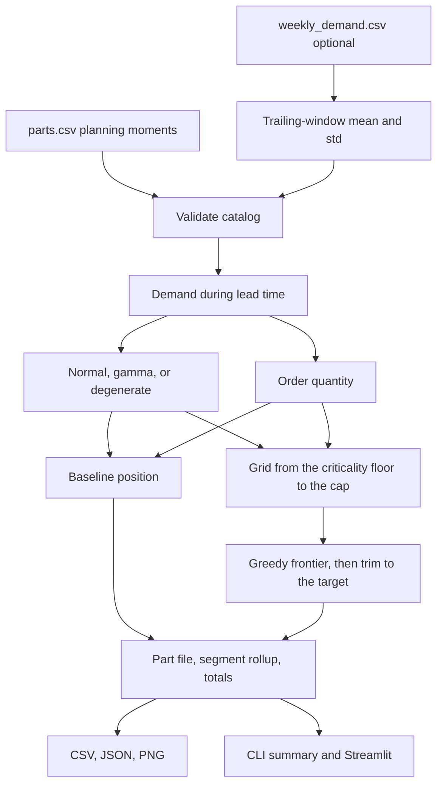

# Architecture

Service Parts Optimizer turns a parts catalog into a safety-stock policy. Forecasting is an input, not the product. The code below the `src/service_parts` package is the policy engine. The command line and the Streamlit screen both call it, so the CSV pack and the screen cannot drift apart.

## Boundaries

| Module | Owns | Does not own |
| --- | --- | --- |
| `data/` | Catalog schema, file loading, trailing-window moments, the synthetic Halden generator | Policy |
| `inventory/math.py` | Demand during lead time, normal and gamma loss, fill rate, cycle service, order quantity | Which target to pick |
| `policy/classify.py` | ABC by annual usage value, XYZ by demand CV | Stock levels |
| `policy/baseline.py` | Weeks-of-cover and uniform cycle-service rules | The efficient frontier |
| `policy/optimize.py` | Per-part grids, the greedy frontier, the trim back to the target | File I/O |
| `pipeline.py` | Prepare parts, build the model, select a target, roll up segments | Chart styling |
| `report/` | Money and percent formatting, PNG charts, the policy-pack files | The decision |
| `cli.py` | `generate` and `run` | Widgets |
| `app/streamlit_app.py` | Review screen: sliders, charts, filters, downloads | A second copy of the math |

`config.py` holds the planning assumptions (target fill rate, holding rate, criticality floors, grid step). `model.py` holds the records those modules pass around: a prepared part, a grid point, the frontier, and the finished pack.

## Data flow

1. Load `parts.csv`. Lead time, unit cost, order cost, minimum order quantity, criticality, and the weekly demand mean and standard deviation are planning parameters.
2. Optionally replace the weekly moments with the mean and sample standard deviation of the last 52 weeks in `weekly_demand.csv`. That path is explicit (`--demand-source history`). The default does not do it. The history shipped with the sample is there so the demand patterns can be inspected, not so the tool can pretend to forecast.
3. Scale lead time if the user is testing a supplier-lead-time reduction. The lead-time coefficient of variation is held constant.
4. Compute demand during lead time and choose a curve. Choose an order quantity from the economic order quantity, rounded up, and at least the minimum order quantity. Both policies share that quantity.
5. Classify ABC and XYZ for the rollup. The classes do not set the stock level.
6. Build the baseline reorder point from weeks of cover, or from one cycle-service level.
7. Build a grid of reorder points for each stocked part, starting at the criticality floor. Walk the grid in order of expected shortages avoided per dollar of on-hand inventory. Trim any step the fill-rate target does not need.
8. Write part-level recommendations, policy totals, segment rollups, the frontier, and two charts.

Parts with no forward demand are outside the fill-rate denominator. A line-down part in that set keeps one unit of insurance stock. Anything else is not stocked.

## What is fixed before the target is chosen

`build_model` freezes lead-time demand, the curve, and the order quantity. Moving the fill-rate target or the baseline rule reuses that model. Changing the holding rate or the lead time builds a new model, because either one changes the economics underneath the frontier. The review screen caches the model and only re-selects the target.

## Invariants the tests lock

- Demand during lead time matches the two-term variance formula on a hand-computed fixture.
- The normal loss matches a numerical integral. The gamma loss matches the exponential closed form and a numerical integral.
- Fill rate is `1 - shortage per cycle / order quantity`, clipped to `[0, 1]`.
- On a small grid, the trimmed recommendation matches an exhaustive search of every grid mix that hits the target.
- Part-file dollars sum to the policy totals. Cycle stock plus safety stock equals on-hand. The system fill rate is demand-weighted, not an average of part fill rates.
- A line-down part with no forward demand is a one-unit insurance position in the recommendation and a zero in the baseline.
- `service-parts run` on a generated catalog writes the CSV pack and two non-empty PNGs.

## Out of scope

- Multi-echelon positioning, lateral transshipment, and repair pools.
- A forecast model. A forecast, or a trailing window, is an input.
- Part-specific holding rates, such as temperature-controlled storage. One holding rate changes order quantities together; it does not, by itself, change which part the safety-stock ranking prefers.
- Service targets written as a shortage cost. The implemented contract is a criticality floor plus one system fill rate, which is how field-service agreements are usually written.

## Extension points

- A new demand source implements the same weekly mean and standard deviation columns and passes them through `apply_demand_source`.
- A new baseline implements `baseline_point` and leaves the frontier alone.
- A shortage-cost objective would replace the fill-rate target inside `choose_indices`. The grid and the loss functions stay.
