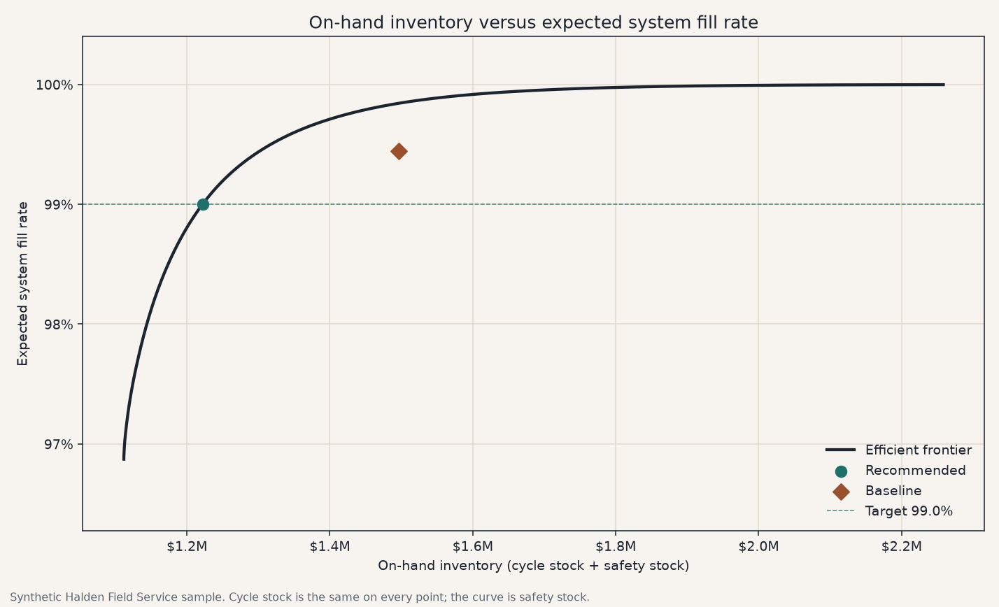
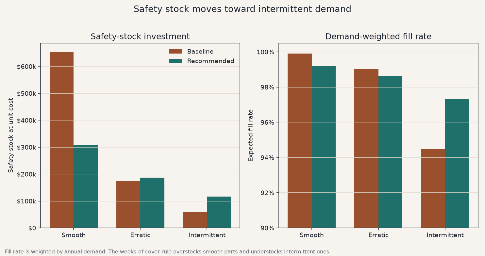

# Service Parts Optimizer

A four-week safety-stock rule can post a 99.4% fill rate and still miss the parts that stop a job. This project sets safety stock from lead-time demand so a service network can see that tradeoff in working capital, not in a forecast chart.

On the synthetic Halden Field Service catalog (200 parts), the weeks-of-cover rule holds **$1.50 million** on hand. A 99% system fill-rate policy with criticality floors holds **$1.22 million**, releases **$275 thousand** of warehouse inventory, and brings every line-down part up to its floor. Fifteen line-down parts miss that floor under the weeks rule. The network average does not show them, because they are intermittent and they are not where the unit volume is.

Halden Field Service is fictional. Part numbers, regions, costs, lead times, and demand are generated in this repo. Nothing here is a real operator, supplier, or customer.

Built by SBroTheLegend. B.Sc Economics, MBA (Finance and Analytics).

## The decision

Service parts tie up cash for a fill rate: the share of units a technician can take off the shelf. Two numbers get confused:

- **Cycle service level** is the probability that a replenishment cycle has no stockout. It says nothing about how many units were short.
- **Fill rate** is the share of demanded units filled from stock. That is the service the field feels, and it is the target this tool buys.

A weeks-of-cover rule puts the same number of weeks of average demand behind every part. Stable, expensive parts get more protection than their fill rate needs. Intermittent parts, including line-down parts, do not. The optimizer keeps a floor under each criticality, then spends the next dollar of safety stock where it prevents the most expected shortages.

Cycle stock is the same under both policies. The cash that moves is safety stock. Pipeline inventory — units already in the lead time — is reported beside on-hand inventory and is not part of the safety-stock decision. A faster supplier reduces it. A weeks-of-cover rule does not release warehouse safety stock when lead time falls, because that rule never looked at lead time. A fill-rate policy does.

## Sample result

Defaults: 4 weeks of cover against a 99% system fill rate, a 20% holding rate, and the Halden sample. Regenerate with the commands below; the figures here match `outputs/summary.json`.

| | Baseline, 4 weeks of cover | Recommended, 99% fill rate |
| --- | ---: | ---: |
| Expected system fill rate | 99.4% | 99.0% |
| On-hand inventory | $1.50M | $1.22M |
| of which safety stock | $887,776 | $613,240 |
| Cycle stock (same either way) | $608,668 | $608,668 |
| Expected unit shortages per year | 163 | 294 |
| Line-down parts below their floor | 15 | 0 |
| Parts below their criticality floor | 27 | 0 |
| Annual holding cost on on-hand inventory | $299,289 | $244,382 |

Working capital released against the weeks rule: **$274,535**. That is a balance-sheet release. The income-statement view of the same stock, at the 20% holding rate, is about **$55 thousand** a year.

Two other readings of the same frontier:

- Matching the baseline's 99.4% fill rate on the efficient frontier holds **$1.30 million** and still releases **$193,848**.
- Spending the baseline's on-hand budget on the frontier instead reaches a **99.8%** fill rate.

Where the safety stock moves:

| Demand pattern | Baseline safety stock | Recommended safety stock | Baseline fill rate | Recommended fill rate |
| --- | ---: | ---: | ---: | ---: |
| Smooth | $654,099 | $308,195 | 99.9% | 99.2% |
| Erratic | $174,729 | $187,289 | 99.0% | 98.6% |
| Intermittent | $58,948 | $116,593 | 94.5% | 97.3% |

Line-down fill rate, weighted by demand, barely moves (99.2% to 99.1%). The fifteen parts that miss the floor are low-volume intermittent items. A demand-weighted average is the right network score and a bad way to see a line-down miss. The floor count is the check.

Pipeline inventory on the sample is **$1.86 million**, more than the warehouse. Cutting every lead time by 25% (`--lead-time-reduction 0.25`), at the same 99% target, takes optimized on-hand inventory to **$1.08 million** and pipeline inventory to **$1.39 million**. The four-week rule's on-hand inventory does not change.





The committed pack is the part file, the policy totals, the segment rollup, the frontier, and these two charts. See [How to run](#how-to-run).

## The math

The planning bucket is one week. A year is 52 weeks. Demand and lead time are treated as independent.

**Demand during lead time.** Weekly demand has mean μ and standard deviation σ. Lead time, in weeks, has mean L and standard deviation σ_L.

```
mean of lead-time demand = μ × L

variance = L × σ² + μ² × σ_L²
```

The first term is demand noise accumulated over the lead time. The second is lead-time noise scaled by the demand rate.

**Which curve.** If lead-time demand is degenerate, shortage is zero once the reorder point covers the mean. Otherwise a normal curve is used when the coefficient of variation is at most 0.80 and the mean is at least 8 units. A gamma curve with the same mean and variance is used for smaller or more skewed lead-time demand. The normal curve can still put a little probability on negative demand; the thresholds keep that small, and the gamma curve is there when it would not be small.

**Order quantity.** Annual demand D = μ × 52, order cost S, unit cost c, holding rate h:

```
EOQ = sqrt(2 × D × S / (h × c))
```

The quantity used is the EOQ rounded up to a whole unit, and at least the minimum order quantity. Both policies use it, so the comparison is safety stock, not a different replenishment cycle.

**Reorder point and safety stock.** For a normal lead-time demand and a cycle service level α:

```
z = Φ⁻¹(α)
safety stock = z × (std of lead-time demand)
reorder point = mean of lead-time demand + safety stock
```

Reported safety stock is never negative. On-hand units are approximated as

```
on-hand = order quantity / 2 + safety stock
```

On-hand inventory valued at unit cost is the warehouse working capital. Pipeline inventory is the mean lead-time demand valued at unit cost. Holding cost in the summary is the holding rate times on-hand inventory only. In-transit ownership depends on shipping terms, so pipeline capital is shown separately and is not run through the holding rate.

**Expected shortage and fill rate.** For a normal lead-time demand the expected units short per replenishment cycle are

```
std × G(z)

G(z) = φ(z) − z × (1 − Φ(z))
```

φ and Φ are the standard normal density and cdf. For a gamma lead-time demand the same role is played by the loss E[(Y − reorder point)+]:

```
mean × S(reorder point; shape + 1) − reorder point × S(reorder point; shape)
```

S is the gamma survival function in the shape-scale parameterization. Unit fill rate:

```
fill rate = 1 − (expected shortage per cycle) / (order quantity)
```

clipped to [0, 1]. This is the standard continuous-review approximation. It is clipped, rather than allowed to go negative, when the expected shortage exceeds one order quantity.

System fill rate weights parts by annual demand:

```
system fill rate = 1 − (sum of expected annual shortages) / (sum of annual demand)
```

Annual shortages equal annual demand times one minus the part fill rate. Parts with no forward demand are left out of both sums.

**Worked example.** Weekly demand averages 20 units with standard deviation 5. Lead time is 4 weeks and does not vary. Lead-time demand averages 80 units with standard deviation 10. At a 95% cycle service level, z is 1.64485 and G(z) is 0.02089.

```
safety stock = 1.64485 × 10 = 16.45 units
expected shortage per cycle = 10 × 0.02089 = 0.209 units
order quantity = 40
fill rate = 1 − 0.209 / 40 = 99.48%
```

At a $200 unit cost the cycle stock is 20 × $200 = $4,000 and the safety stock is about $3,290, so on-hand inventory is about $7,290. The fill rate is much higher than the 95% cycle service level because the order quantity is large relative to the shortage. That gap is why a single cycle-service target is a poor proxy for the fill rate a network actually delivers.

**Criticality floors, then the frontier.** Each stocked part starts at the cheapest reorder point that meets its floor:

| Criticality | Minimum fill rate |
| --- | ---: |
| Line-down | 98.5% |
| Degraded | 96% |
| Convenience | 90% |

A line-down part with no forward demand keeps one unit on the shelf. That unit is insurance stock, not a replenishment cycle, and it is outside the fill-rate calculation.

Above the floors, protection is raised in steps of 0.025 on the normal score of the cycle service level, up to 3.5. Each step has a cost (the extra on-hand inventory) and a benefit (fewer expected shortages per year). Expected shortage is convex in the reorder point, so each step prevents fewer shortages per dollar than the step before it. Taking the available steps in that order traces the convex efficient frontier. A coarse step can overshoot the target; any step that can be removed without falling through the target is removed, worst dollar first. The part file is that trimmed policy.

The baseline on this sample is four weeks of average demand as safety stock, on top of lead-time demand. A uniform cycle-service baseline is available with `--baseline cycle_service`.

## Architecture

Module boundaries and the data flow are in [ARCHITECTURE.md](ARCHITECTURE.md). In short: `inventory/math.py` is the loss function and the order quantity, `policy/optimize.py` is the frontier, `pipeline.py` is the only place a catalog becomes a policy pack, and both the CLI and the Streamlit screen call that pipeline.

## Repository layout

```
app/streamlit_app.py          Review screen
src/service_parts/            Policy engine
data/halden_sample/           Synthetic catalog, weekly history, manifest
outputs/                      Sample policy pack and charts
tests/                        Math fixtures, frontier check, pipeline smoke test
```

## How to run

From the repository root, with Python 3.11 or newer:

```bash
python -m venv .venv
source .venv/bin/activate
pip install -e ".[dev]"
pytest
python -m service_parts.cli run
streamlit run app/streamlit_app.py --server.port 47321
```

On Windows, activate with `.venv\Scripts\activate`. `requirements.txt` lists the same dependencies if you prefer `pip install -r requirements.txt`; the editable install above is what puts the `service_parts` package on the path.

`pytest` needs nothing else. The policy pack is:

```bash
python -m service_parts.cli run
```

That reads `data/halden_sample` and writes:

| File | What it is |
| --- | --- |
| `outputs/policy_recommendations.csv` | One row per part: baseline and recommended stock, fill rate, and investment |
| `outputs/policy_totals.csv` | Baseline, recommended, matched-fill, and same-budget totals |
| `outputs/segment_summary.csv` | Rollups by criticality, ABC, XYZ, demand pattern, and commodity |
| `outputs/tradeoff_curve.csv` | On-hand inventory against system fill rate |
| `outputs/summary.json` | The figures in the sample table |
| `outputs/tradeoff_curve.png` | The frontier, with the baseline and the recommendation marked |
| `outputs/before_after_demand_pattern.png` | Safety stock and fill rate by demand pattern |

Useful switches:

```bash
python -m service_parts.cli run --target-fill 0.995 --cover-weeks 3
python -m service_parts.cli run --baseline cycle_service --cycle-service 0.95
python -m service_parts.cli run --lead-time-reduction 0.25
python -m service_parts.cli run --demand-source history --history-window 52
python -m service_parts.cli generate --seed 42 --parts 200 --weeks 156
```

`generate` rewrites the synthetic catalog. The default seed reproduces the committed sample. `--demand-source history` replaces the catalog's weekly mean and standard deviation with the trailing window. It is still not a forecast.

The review screen opens on the same sample. The target, the baseline, the holding rate, and a lead-time reduction are on the sidebar. The metrics at the top stay on the whole network when the part table is filtered. Downloads follow the sliders, so a scenario does not have to be written to `outputs/` first.

## Tests

```bash
pytest
```

The suite covers three things:

- Core inventory math against known fixtures: the lead-time variance split, G(0) = 1/√(2π), the normal loss against an integral, the gamma loss against the exponential closed form and an integral, the fill-rate identity, and the EOQ.
- Policy comparison totals: part-file dollars sum to the reported totals, cycle stock plus safety stock equals on-hand, and the system fill rate is the demand-weighted identity. A separate test checks the frontier against an exhaustive search on a three-part grid.
- A smoke test: generate a small catalog, run the CLI, and require the CSV pack plus two real PNG files. The committed Halden sample is checked as fictional, complete, and solvable at the default target.

## Assumptions and limits

- One echelon. The sample is a national stocking point, not a network of branches.
- Continuous review (reorder point, order quantity). The fill-rate formula is the standard cycle approximation, clipped at zero and one.
- One holding rate for every part. It changes order quantities. Because it is common, it does not by itself change which part a dollar of safety stock prefers; unit cost already does that.
- The grid step is 0.025. The recommendation is the trimmed frontier on that grid, not a continuous closed form.
- No repair loop, no pooling, and no lateral transshipment. Those change the lead-time demand this tool would then take as an input.

## License

[MIT](LICENSE). Copyright 2026 SBroTheLegend.
